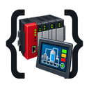

# RockwellMCPServer



Shared Rockwell engineering service with MCP, REST, a desktop GUI and reloadable extensions.

[CodexMCPBroker](https://github.com/votecoffee/CodexMCPBroker) provides the separately maintained shared application framework and Windows MCP Service Manager. Rockwell remains a standalone MCP server with its own app-owned Codex plugin and skills. The optional framework host and separate management app require no universal plugin; Rockwell retains reviewed dependency pins and deployment-specific acceptance.

The shared Windows MCP Service Manager can report this app's service activity and installed/running versions through an app-owned supervisor. Tray restart remains disabled until full engineering quiescence can be enforced; see [service management](docs/SERVICE_MANAGEMENT.md). Small packaged skills fetch current canonical guidance from the shared service; compatible clients can explicitly select [Skills-over-MCP publication](docs/FRAMEWORK.md#current-guidance-and-skills-over-mcp). The read-only [protocol feature report](docs/PROTOCOL_FEATURES.md) lists tested features and concrete gaps.

Inspect and edit **Studio 5000 Logix Designer**, **FactoryTalk View Studio ME/SE** and **Studio 5000 View Designer** project exports from a Codex chat or the desktop workspace. Browse tags and UDTs, create watch lists, record values and export trends. Optional Logix Designer SDK jobs provide native project and configured controller operations.

All clients use one authenticated local service and the same operations. Source files are preserved; reviewed changes create managed revisions and new exports. Controller operations are disabled by default.

If skills appear but chat tools are missing, use the optional [connection readiness diagnostic](docs/READINESS.md). It separates installed/cache metadata, loader configuration, the serving version/policy, resource admission and the requesting chat's actual tools, with an explicit cached-launcher compatibility fallback.

Scoped structural reviews can inspect up to 128 exact element paths in one context request, retaining source/value fingerprints and protected flags while reducing repeated client calls. The GUI exposes this under **Diagnostics & workflows → Scoped structural batch**; see the [structural workflow](workflows/rockwell-engineering/references/structural-edits.md).

The plugin identifier is `rockwell-mcp-server`. Internal `Studio5000.*` assemblies, environment variables and existing tool names remain for compatibility.

Application releases use a fixed `YY.MMDD.HHmmss` timestamp in `America/New_York`, currently **26.1023.132350**. Package identities remove leading numeric zeros when required; the padded display timestamp stays in release metadata. See [release versioning](docs/VERSIONING.md) for package and .NET mappings.

## Table of Contents

- [Background](#background)
- [Install](#install)
- [Usage](#usage)
- [Documentation](#documentation)
- [Validation](#validation)
- [API](#api)
- [Maintainers](#maintainers)
- [Contributing](#contributing)
- [License](#license)

## Background

RockwellMCPServer gives agents and engineers a shared workspace for project inspection, controlled edits and repeatable exports. The MCP adapter and Windows desktop call the same service, so changes and watch lists are visible across clients.

| Capability | Scope |
|---|---|
| Logix project editing | Inspect and preview/apply L5X component changes; export L5X or exploded ZIP. Optional SDK conversion supports ACD files. |
| Project review | Compare hash-bound Logix snapshots, find PLC tag where-used candidates in saved RLL/ST and direct aliases, and preview ladder branches as drawing geometry and passive SVG. |
| Logix SDK jobs | Ordered native calls for projects, builds, imports, typed/raw tags and other operations in the bound SDK version. Availability depends on the installed Logix version and project. |
| [Native-local candidate](docs/NATIVE_LOCAL_PILOT.md) | Separately prepare a hash-bound `local-project` SDK read/export/offline-import/build profile with dedicated state/registry and controller, SCM-start and GUI boundaries. Native acceptance remains a separate pilot. |
| [SDK service recovery](docs/SDK_SERVICE_RECOVERY.md) | Start a stopped Logix Designer SDK Service from chat or the GUI, or before new SDK work. Retain request receipts and leave a running service running. |
| FactoryTalk View ME/SE | Edit existing graphics XML properties using matching installed schemas; resolve tag references against saved PLC metadata using explicit shortcut/parameter context, prepare import packages and compare re-exports. |
| View Designer | Edit existing properties in exported `.hmi` folders, preserve assets, prepare import ZIPs and compare re-exports. |
| Tag/UDT browser and watches | Search snapshot structures, expand members/arrays, create stopped watch lists, poll authorized tags and extract structures as JSON. |
| Watch preflight | Check drafts, saved lists and browser selections; report each unsupported tag, source changes, configuration failures and combined CIP read budgets without connecting. |
| Portable watch templates | Export selections/settings, preview explicit project/program bindings and import a new stopped list with a checked review hash. |
| Watch source rebinding | Preview declaration/scope changes and move a stopped list to a new snapshot while retaining its ID, settings and recording revisions. |
| Tag value merge | Preview selected values from saved or uploaded PLC snapshots, check UDT/array layouts and merge into a different offline project. GUI supports capture and new L5X/ACD exports. |
| Saved comparison sessions | Persist pinned hashes, filters and ladder bookmarks; review recovery to changed snapshots with revision/hash checks. |
| Comparison reports and history | Export all matching differences as standalone HTML/JSON with optional XML and passive ladder drawings; retain verified reports across project changes. |
| Comparison review notes | Mark recorded changes reviewed or needing attention, retain searchable notes/progress and export a separate notes snapshot with revision checks. |
| Reusable merge mappings | Import/export portable JSON name pairs, bind to explicit snapshots/program scopes and generate a fresh value preview. |
| Optional CIP reader | Read bounded scalar/UDT/array symbols through an isolated libplctag worker; plan reads offline and share watch recording/trends. Live validation pending. |
| Trending and recording | Save/edit named views, graph values and gaps, gather paged statistics, export exact JSON results/CSV and retain history across restarts. |
| Diagnostic workflows | Trace readers/writers and AOI dependencies, explain captured rung conditions and record bounded pre/post trigger windows tied to a project revision. |
| Multilingual documentation | Extract/search tag and rung comments, component/UDT/AOI descriptions and existing extended text; preview explicit language edits while preserving other translations. |
| HMI languages | Browse/review/edit FactoryTalk ME/SE and View Designer workbook/Unicode exports, add language columns, preserve native keys and compare supplied re-exports. |
| Logic/value preservation | Merge reviewed program routines while retaining all fresh saved tag records/representations and configuration, with exact MESSAGE field exceptions and reviewed preservation receipts. |
| Scalar XML preservation | Edit PLC/FactoryTalk text and existing attributes while retaining source encoding, BOM, line endings and every unselected byte. |
| Controller-tag rename | Review scoped references, ambiguous operands and safety handling; publish a separate byte-preserved project with all saved values and a reference receipt. |
| [Module connection timing](workflows/rockwell-engineering/references/module-connections.md) | Browse exact RPI/delay/reaction-time fields, review source/hash/before-values and safety metadata, then publish a separate byte-preserved review copy and receipt. |
| [Scoped structural review](workflows/rockwell-engineering/references/structural-edits.md) | Edit scoped routines/tags/UDTs with raw source preservation, exact reference AOI/UDT additions, saved-state decisions and retained preview/apply receipts identifying their producer and version. |
| Named validation profiles | Offline integrity, whole-project merge preservation and existing native readback comparison, with new/inherited/expected findings and immutable machine-readable receipts. |
| Version workflows | Separate native upgrade/readback jobs and bounded v35-to-v32 review-only L5K preparation, with explicit compatibility boundaries. |
| Reloadable extensions | Discover operation schemas and reload compatible modules through MCP or the GUI while the host and chat remain running. |
| Codex plugin | Standalone plugin with live capability discovery and shared versioned workflow guides. |
| Optional shared framework | App-owned Python host pinned to framework 0.20 / SDK 2.3, with immutable C# backend publications and a fixed discovery interface. |
| Service settings | GUI editing for controller/file access, target scopes, SDK/HMI paths and limits; broad local profile, backups and saved-versus-running configuration. |
| Concurrent requests and transactions | Edit independent workspaces concurrently; stage/review/commit offline changes as one revision with conflict checks, abort and durable retry receipts. Bundled stateless extensions support parallel worker pools. |

L5X explode/implode uses the MIT-licensed L5xploder library from `ra-logix-designer-vcs-custom-tools`. See [third-party provenance](THIRD_PARTY_NOTICES.md).

Exploded ZIPs use legacy schema 1. Newer layouts, protected AOIs and structured-text metadata that this layout cannot preserve are rejected explicitly; L5X exports remain available. See [exploded-project compatibility](docs/EXPLODED_PROJECTS.md).

## Install

### Dependencies

- Windows and the [.NET 8 SDK](https://dotnet.microsoft.com/en-us/download/dotnet/8.0), including desktop and ASP.NET Core runtimes.
- Git and PowerShell for the commands below.
- For ACD/native operations: a licensed, installed Logix Designer SDK and compatible Logix Designer versions. The bridge currently binds SDK **2.1.974**.
- For FactoryTalk XML mutation/import preparation: the matching installed ME/SE graphics schemas. Native import requires FactoryTalk View Studio.
- For native View Designer import/build: Studio 5000 View Designer. Export-folder editing itself needs no native executable.

**Logix Designer v38 is supported** through the existing XML, SDK, REST/MCP and GUI paths. Native v38 operations require the installed compatible v38 engine; see [version support and offline verification](docs/LOGIX_VERSIONS.md).

Proprietary SDK binaries, schemas and activation files are not distributed in this repository.

### Install and launch

Run in PowerShell:

```powershell
git clone https://github.com/votecoffee/RockwellMCPServer.git
cd RockwellMCPServer
.\Install.cmd
.\Run.cmd
```

You can also double-click **Install.cmd**, then **Run.cmd** in File Explorer. Installation builds the shared service, MCP adapter, GUI and extensions, initializes local settings on first use and creates a **RockwellMCPServer** shortcut in the current user's Start Menu. The executable, application windows and shortcut use the bundled PLC/HMI artwork, with eight exact-size Windows icon frames for different display scales. No administrator access is needed. The shortcut starts the shared service and GUI with no console window; startup errors appear in a dialog.

Both root commands accept `--help`, `-Help`, `-?` or `/?` without entering installation/startup. They preserve quoted arguments and propagate the PowerShell exit code. For example, `Run.cmd -ProjectPath "C:\Projects\project file.L5X"` accepts spaces. See the [installation and wrapper contract](docs/INSTALLATION.md).

Installation uses Rockwell's **standalone Codex plugin**, preserving its enabled/disabled choice on reinstall. Use `Install.cmd -CodexIntegration None` for the app alone. Broker routing and automatic route selection have been removed. See [standalone plugin installation](docs/CODEX_INTEGRATION.md).

Each application owns its Codex plugin and native skills. Common infrastructure consists of the shared app framework and an independent Windows manager. The framework's `universal-codex-tools` package name remains a compatibility identifier; it does not select or install a universal plugin.

If skills appear while tools are missing, follow the [MCP discovery and reconnect checks](docs/CODEX_INTEGRATION.md#skills-appear-but-tools-are-missing). Plugin installation and a working service do not establish that Codex loaded the tools.

If you authorize continuing through the installed service while MCP is unavailable, the [documented REST fallback](workflows/rockwell-engineering/references/structural-edits.md#authorized-rest-fallback) keeps the same review and receipt guards. Requested named L5X copies are saved with hash readback after the edits and required scoped checks; native import/build remains a separate user-owned or separately requested step.

Reinstallation refreshes enabled standalone plugins owned by this installation. For disabled plugins, it publishes updated guidance for a later host refresh and keeps them disabled. Existing packages from other installations are retained.

Run **Install.cmd** again after updating the checkout. Finish jobs, stop watch polling, close clients and run `.\scripts\Stop-Service.ps1` first; the installer refuses to rebuild applications that are running from this checkout. Existing `service.local.json` is preserved. Bundled extensions receive content-qualified build versions and are selected for the next service startup; earlier immutable versions remain available for rollback. Use `Install.cmd -NoShortcut` to omit the shortcut, or `Install.cmd -SkipBuild` to configure an already published build and recreate its shortcut without changing extension selections. Keep the checkout in place; rerun installation if you move it. Delete the Start Menu shortcut to remove that entry.

Adding the standalone plugin for the first time with `-SkipBuild` can leave the service running. Refreshing an already enabled plugin still requires an idle app. Legacy integration receipts are archived when migrating to standalone; external registrations remain untouched.

This starts with the generated inputs under `examples/`. Add an existing source directory with `.\scripts\Initialize.ps1 -AllowedRoot 'C:\Projects\Rockwell'`. Initialization protects local credentials/state for the current Windows user and SYSTEM. The lower-level `Build.ps1`, `Initialize.ps1`, `Start-Service.ps1` and `Start-Gui.ps1` scripts remain available under `scripts/`.

For optional native SDK support, use `.\Install.cmd -WithSdk`. This builds/configures the installed SDK bridge and does not enable controller operations.

For the optional read-only CIP watch backend, use `.\Install.cmd -WithCip`, then configure an explicit target route. Both optional switches can be combined. Existing watches default to the SDK backend. See [CIP reader setup, offline planning and validation limits](docs/CIP_READS.md).

Use **Preflight draft…** in the watch window or **Preflight selection…** in the tag browser to inspect declarations and configuration before polling. The same read-only operation is available through REST and the extension catalog; see [watch preflight](docs/WATCH_PREFLIGHT.md).

Use **Export saved template…** and **Import template…** in the watch window to reuse selections/settings with another snapshot. Templates omit source paths, controller routes and live data; import previews exact program mappings and creates a stopped list. See [portable watch templates](docs/WATCH_TEMPLATES.md).

Use **Rebind source…** to update the saved snapshot for an existing stopped list. Preview declaration changes, apply the reviewed binding and retain older recordings under their original revisions. See [watch source rebinding](docs/WATCH_REBIND.md).

Local settings are in ignored `service.local.json`; use [service.example.json](service.example.json) as the portable reference. By default, `AllowedRoots` controls source access, `OutputRoots` controls new saved exports, and the output directory is `artifacts/exports`. Restart the service after configuration changes.

Open **Settings…** to edit these options, controller targets and runtime limits in the GUI. **Broad local access** prepares unrestricted file access and explicit SDK routes while clearing target method/scope restrictions. Save stages changes with a backup and leaves live polling/jobs unchanged; the GUI shows what needs a restart. Public defaults remain restricted. See [settings and access policies](docs/SETTINGS.md).

## Usage

### CLI

After the initial build/configuration, start the shared service and GUI together:

```powershell
.\Run.cmd
```

Pass `-ProjectPath "C:\Projects\Rockwell\Example.L5X"` to open a project at launch. The Start Menu shortcut also starts the service and GUI together. Closing the GUI leaves the shared service running for other clients and watches.

Use `scripts/Start.ps1` for the equivalent PowerShell entry point, `Start-Service.ps1 -Background` for the service alone, `Start-Gui.ps1` for another desktop client, and `Stop-Service.ps1` to stop the recorded background service. Finish active jobs and stop watch polling before replacing host binaries.

### Connect an MCP client

Start the service first. Installation packages a small standalone Codex plugin with portable/compatibility manifests, three bootstrap skills and a launcher pointing at the app installation. It excludes projects, credentials, build outputs and service state. To configure integration separately, run `.\scripts\Configure-Codex.ps1 -PlanOnly`, inspect the result, then run without `-PlanOnly`. The REST URL is not an HTTP MCP endpoint.

For direct Codex MCP registration, run from this checkout:

```powershell
codex mcp add rockwell-mcp-server -- powershell.exe -NoProfile -ExecutionPolicy Bypass -File (Join-Path (Get-Location) 'scripts\Start-Mcp.ps1')
```

The launcher starts the stdio MCP adapter and connects it to the shared service. Direct MCP registration does not install the bundled bootstrap skills; they are available under [skills/](skills/). Detailed guides and references have one maintained source under [workflows/](workflows/). Connected chats read them through ordinary versioned, hash-bound app tools. Changed embedded guidance needs a shared-service deployment; after deployment, fetching a new revision does not require replacing native skills or tool schemas.

The Windows adapter limits new frontend instances using OS-owned file leases and observes its launcher/parent handles. Configure the limit and shutdown timeout in **Settings…**. Closing a frontend leaves the shared service available to other clients. See [process ownership and outstanding lifecycle validation](docs/PROCESS_LIFETIMES.md); source implementation does not establish installed runtime cleanup acceptance.

The service contains bounded Windows process jobs and a durable resource ledger. Extension, CIP and SDK workers use atomic contained creation; SDK sessions retain separate save/close/effect evidence and recovery barriers. Operator/console stop uses identity-bound requests with refusal ahead of teardown. Native GUI launch hands off to the user desktop shell; Studio and its documents remain user-owned. MCP startup reconciles only fully identified exited transport generations, preserving unbound reservations and native uncertainty. The optional framework supervisor additionally requires its ownership handshake and verified service close evidence. GUI settings expose process, resource and frontend limits. See [resource ownership](docs/RESOURCE_LEDGER.md) and the [separate native-local candidate/pilot](docs/NATIVE_LOCAL_PILOT.md). Offline protocol, harmless-worker, native operation and deployment/chat acceptance are distinct evidence; preparing a candidate does not activate it.

Example chat request using the generated L5X fixture:

```text
Register examples/Demo.L5X using its absolute path. Inspect the ladder routines,
preview a rung-comment change, apply it and save a new L5X under the configured
output directory.
```

Inspect/read before editing. Preview binds the requested changes to a source hash; apply requires that preview and its current base hash. Refresh after a stale-revision error. Tool schemas and the live extension catalog describe available operations.

### Desktop workspace

Open a Logix or FactoryTalk export, inspect a component, then **Preview edit**, **Apply preview** and export a new file. **View Designer…** opens the exported-project workspace.

**Compare projects…** opens two ACD/L5X files or registered snapshots and shows structural changes, XML differences and a program/AOI routine tree with side-by-side aligned ladder browsing. **Browse selected change…** jumps to the exact selected rung. Inserted/deleted rungs retain explicit gaps, and a changed-rung filter supports focused review. This uses the app's own comparison engine. **Ladder preview…** also browses a single routine. See [project review](docs/PROJECT_REVIEW.md).

**Merge tag values…** reads a saved project or captures an authorized online upload, searches/pages tag candidates and merges reviewed values into a different offline working copy. Selections persist across pages/searches, with up to 256 tags per merge. Declaration/layout mismatches block apply. Export a separate L5X/ACD after merging; see [value merge](docs/VALUE_MERGE.md).

Save and reload named comparison sessions in **Compare projects…**, retaining snapshot hashes, filters and the selected ladder row. **Review recovery** compares explicitly selected current snapshots; **Save reviewed recovery** updates their pins and clears the old bookmark. In the merge window, **Reusable mappings…** edits/saves whole-tag name pairs, imports/exports portable JSON and binds to the selected project/program scopes for a fresh value preview. Definition updates detect concurrent edits. See [saved reviews and mappings](docs/SAVED_REVIEWS.md).

Use **Export report…** to save every matching comparison change as HTML or JSON, optionally including normalized XML snippets and passive ladder drawings. **Report history…** searches retained reports, saves verified copies and reopens unchanged recorded snapshots. Reports retain their original hashes after a project changes. See [comparison reports](docs/COMPARISON_REVIEWS.md).

In report history, **Review changes / notes…** tracks review states and notes for each recorded change. Drafts remain available across pages and filters; concurrent saves use the loaded report/review revision. Export a separate JSON notes/progress snapshot without changing the report. See [annotations](docs/COMPARISON_REVIEWS.md#annotations).

For FactoryTalk displays, **Tag references** shows extracted occurrences and source expressions. **Resolve references…** maps shortcuts to saved Logix snapshots, binds parameters to exact objects/groups and searches the resulting tag/UDT/array checks. The read-only `ftview_tag_references` and `ftview_resolve_references` extension operations expose these features through the live catalog. Missing context, unavailable metadata and absence in a potentially partial snapshot have separate statuses. These checks do not connect to a PLC. See [FactoryTalk reference resolution](docs/FACTORYTALK.md#plchmi-reference-resolution).

Use **Tag / UDT browser…** to search tags, expand structures/arrays and create a watch list from selected values. **Watch lists…** provides polling controls and extracted values; **Trends & recording…** provides graphs, retention and CSV. Saving a watch list does not connect. Lists restart stopped; closing a viewer does not stop already active shared polling.

Use **PLC where used…**, **Where used…** in the tag browser, or **Where used in PLC…** on a matched HMI reference to inspect saved RLL/ST candidates and direct alias declarations. Results show source locations and distinguish indirect index expressions. Open a selected RLL candidate in the ladder viewer with its snapshot hash and exact rung position. These lexical checks do not establish compiler binding or prove a tag is unused. See [tag where-used coverage](docs/TAG_REFERENCES.md).

**Extensions…** exposes the live catalog, operation forms, reload and jobs. Compatible extension updates can be reloaded without restarting Codex. Shared host, SDK binding or contract changes can require a service restart; see [extension updating and rollback](docs/EXTENSIONS.md).

**Diagnostics & workflows…** groups logic tracing, captured rung explanation, triggered recording, whole-project keep-current-values merging, preservation/integrity validation, legacy review-copy preparation and native version compatibility. Choose saved snapshots and watch context, then open a populated operation editor. **Trends & recording…** also saves/loads/updates trend views, gathers bounded statistics and exports hash-bound results. These workflows preserve source revisions and leave polling stopped unless it is started separately. Use the separate candidate/readback selector for validation. See the [merge and validation workflow](workflows/rockwell-engineering/references/logic-value-merge.md), [legacy review-copy workflow](workflows/rockwell-engineering/references/legacy-review-copy.md) and [diagnostic/trend workflows](docs/DIAGNOSTICS.md).

**Documentation…** searches multilingual project text, stages language-specific tag/member/rung comments and component descriptions, previews before/after translations and applies a reviewed managed revision. Plain text keeps an explicit unlocalized identity; adding translations requires naming its original language. Export all matching text as JSON or hand off a separate L5X/ACD. See [multilingual documentation](docs/PROJECT_DOCUMENTATION.md).

**HMI languages…** edits language exports from FactoryTalk View ME/SE and View Designer. Search native string identities and translations, stage explicit text/new language columns, preview/apply a managed revision and export a separate native language file. OpenXML `.xls`/`.xlsx` and Unicode `.txt` are supported, including View Designer v9 metadata/context columns and implicit cell addresses. Native source-language keys are read-only; identical text on different objects stays distinct. Legacy binary Excel is rejected explicitly. Original files, keys and other languages are preserved. Native Studio import and layout/runtime validation remain separate. See [HMI multilingual text](docs/HMI_LANGUAGES.md).

**Transactions…** creates a private workspace snapshot, stages typed XML/documentation/HMI edits, reviews the complete result and commits all stages as one revision. Independent workspace writers can overlap; competing edits to the same source are checked explicitly. Transactions survive restart and retain safe commit-retry receipts. They cover one offline workspace at a time; native/controller operations and external saves remain separate. See [concurrent requests and transactions](docs/CONCURRENCY_TRANSACTIONS.md).

To generate a Studio 5000 Custom Tools entry, run `.\scripts\New-CustomToolsMenu.ps1`. It writes `artifacts/CustomToolsMenu.xml` for manual merging into Studio's installed menu and passes the saved project path to the GUI. The generator does not change the Studio installation.

### Native workflow boundaries

FactoryTalk and View Designer editing operates on exports. Import the prepared content into the intended native project, inspect/build/save as applicable, then re-export for comparison. Direct FactoryTalk binary editing, VPD/VPDR editing and HMI runtime deployment are outside these workflows.

Logix online plans require an explicitly configured and authorized target/action. SDK import-time finalization is available, but the bound SDK has no standalone Test/Untest/Assemble Edits calls. Controller Test mode is different from Test Edits. See [online edits](docs/ONLINE_EDITS.md).

XML checks, file comparisons and successful SDK calls do not establish native HMI acceptance, functional controller behavior or commissioning approval.

## Documentation

| Guide | Contents |
|---|---|
| [Architecture](docs/ARCHITECTURE.md) | Shared service, storage, authentication and process boundaries |
| [Settings and access](docs/SETTINGS.md) | GUI configuration, broad local preset, target policies, backups and pending restart state |
| [Codex integration](docs/CODEX_INTEGRATION.md) | Standalone plugin packaging, app discovery and versioned workflow guides |
| [Optional app framework](docs/FRAMEWORK.md) | Separate host package, pinned dependencies, backend publication, isolation and verification boundaries |
| [Logix SDK](docs/SDK.md) | Bound catalog, native jobs and controller target policies |
| [Diagnostics and trends](docs/DIAGNOSTICS.md) | Logic tracing, captured conditions, trigger windows, saved trend results, baseline merging and native compatibility |
| [Multilingual documentation](docs/PROJECT_DOCUMENTATION.md) | Explicit languages, tag/rung/component comments, reviewed updates and text extraction |
| [HMI multilingual text](docs/HMI_LANGUAGES.md) | FactoryTalk ME/SE and View Designer language workspaces, native-file export and re-export comparison |
| [Concurrent requests and transactions](docs/CONCURRENCY_TRANSACTIONS.md) | Resource scheduling, parallel MCP workers, private stages, atomic workspace commit and restart recovery |
| [Project review](docs/PROJECT_REVIEW.md) | Structural comparison, rung alignment and read-only ladder previews |
| [Tag value merge](docs/VALUE_MERGE.md) | Offline value transfer, online source capture, layout checks and new L5X/ACD exports |
| [Saved reviews](docs/SAVED_REVIEWS.md) | Persistent comparison sessions and reusable merge mappings, revision checks and fresh binding previews |
| [Comparison reports](docs/COMPARISON_REVIEWS.md) | Complete filtered HTML/JSON reports, passive ladder drawings, report history and revision-controlled review notes |
| [Online edits](docs/ONLINE_EDITS.md) | Planning, import dispositions and native lifecycle |
| [FactoryTalk View](docs/FACTORYTALK.md) | ME/SE graphics editing and native import handoff |
| [View Designer](docs/VIEW_DESIGNER.md) | Export syntax, property editing and native handoff |
| [Watches and UDTs](docs/WATCHES.md) | Polling, value extraction and controller structure snapshots |
| [Watch preflight](docs/WATCH_PREFLIGHT.md) | Draft/saved/browser diagnostics, source hashes and combined read budgets |
| [Watch templates](docs/WATCH_TEMPLATES.md) | Portable JSON export, exact program mappings and reviewed stopped-list import |
| [Watch source rebinding](docs/WATCH_REBIND.md) | Declaration comparisons, reviewed source updates and retained revision history |
| [Optional CIP reader](docs/CIP_READS.md) | Symbolic read plans, configured routes, supported types and offline-only validation |
| [Browser and recording](docs/BROWSER_RECORDING.md) | Search, watch creation, trends, retention and CSV |
| [PLC where-used](docs/TAG_REFERENCES.md) | Scoped lexical references, source locations, indirect indices and desktop navigation |
| [Extensions](docs/EXTENSIONS.md) | Contracts, packaging, live reload and rollback |
| [Exploded projects](docs/EXPLODED_PROJECTS.md) | Format compatibility and loss-prevention checks |
| [Community integrations](docs/COMMUNITY.md) | Candidate libraries, licenses and adoption priorities |
| [Examples](examples/README.md) | Generated demonstration inputs and their limits |

## Validation

Run isolated development verification without a configured native bridge or controller:

```powershell
.\scripts\Verify-Isolated.ps1
```

This checks core operations, REST/MCP transport, extension reload and off-screen desktop rendering in separate state. FactoryTalk schema checks depend on installed schemas. Results stay under ignored `artifacts/isolated-validation/`. See [validation procedures](docs/VALIDATION.md) for outputs, optional offline SDK checks and separate native/live validation requirements.

## API

See [the REST and MCP reference](docs/API.md). The service uses authenticated loopback HTTP (default `http://127.0.0.1:5487`); `.local/connection.json` identifies the running URL and credential file. Keep credentials local.

## Maintainers

[@votecoffee](https://github.com/votecoffee)

## Contributing

Questions and bug reports belong in [GitHub issues](https://github.com/votecoffee/RockwellMCPServer/issues). Focused pull requests are welcome; see [CONTRIBUTING.md](CONTRIBUTING.md) for layout, development and validation requirements.

Keep personal/customer notes and deployment records outside the checkout or under ignored `.local/private-docs/`. Only reusable public documentation and generated examples belong in the tracked tree.

## License

[MIT](LICENSE) © 2026 votecoffee. Vendored L5xploder source is MIT © 2025 Rockwell Automation; see [third-party notices](THIRD_PARTY_NOTICES.md).
